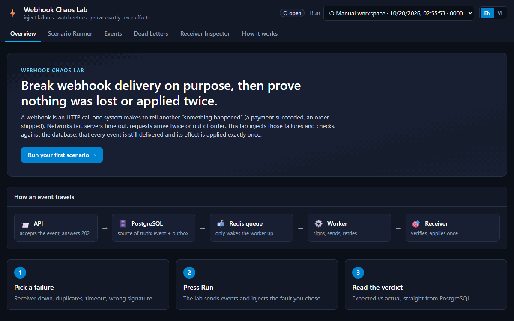
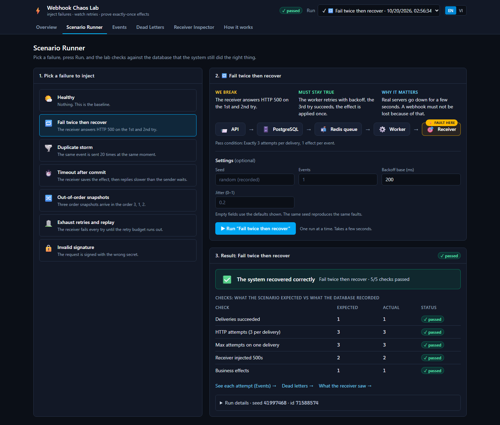
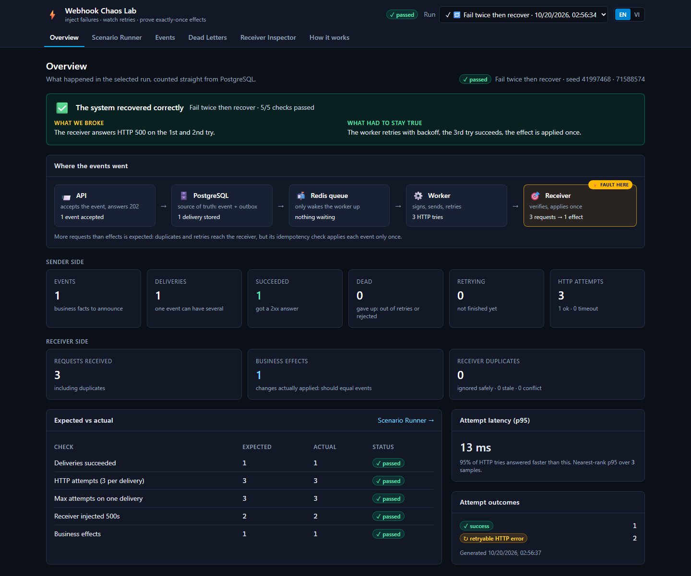
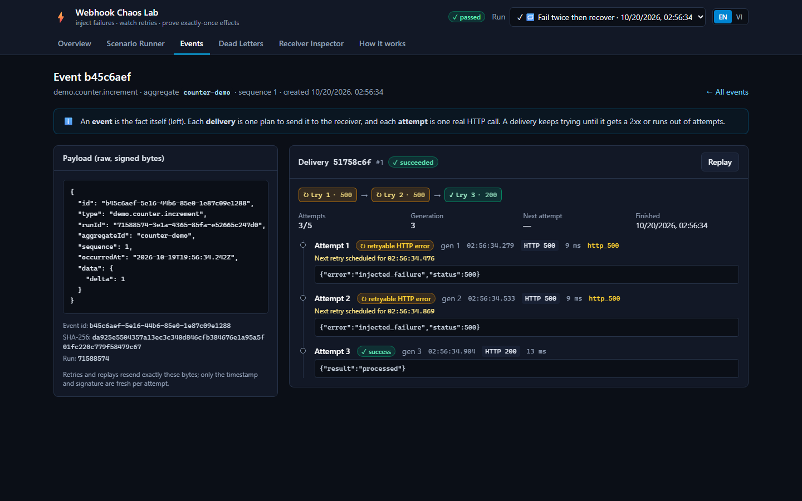
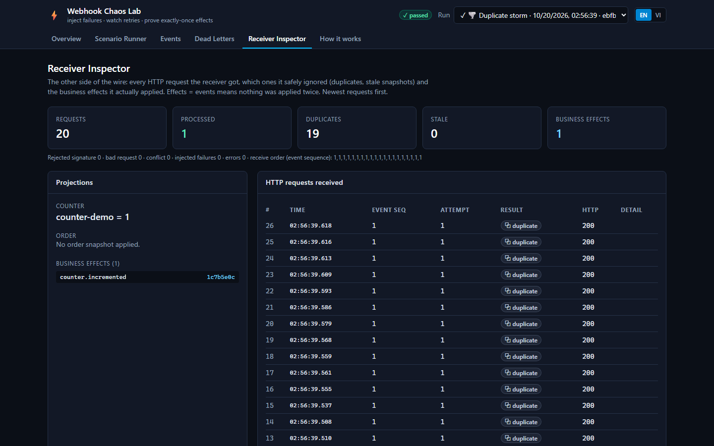
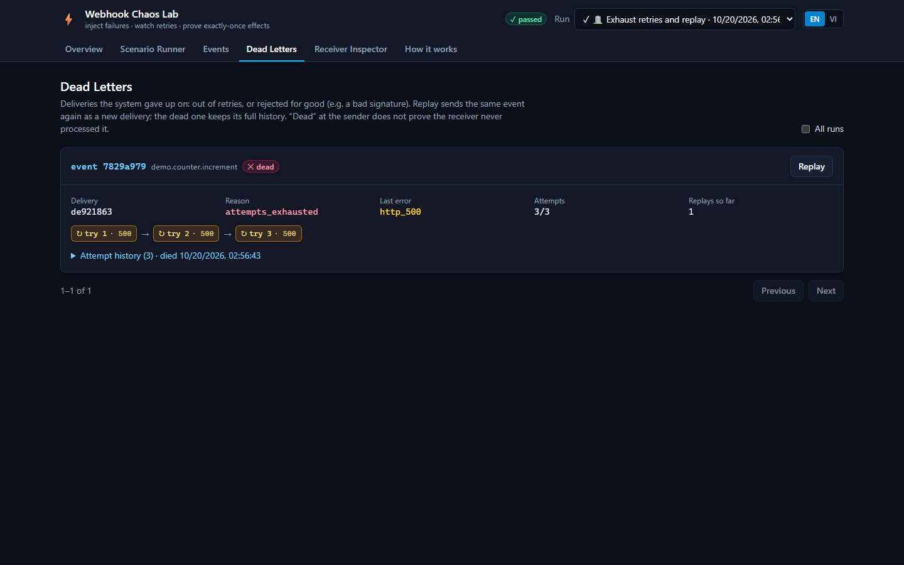
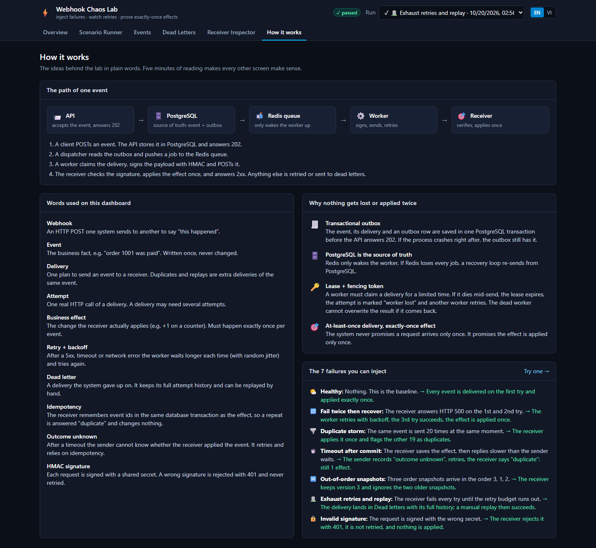
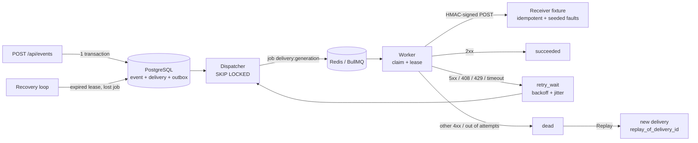

# Webhook Chaos Lab

[](https://github.com/mheal86/webhook-chaos-lab/actions/workflows/ci.yml)
· [Tiếng Việt](README.vi.md)

**Break webhook delivery on purpose, then prove nothing was lost or applied twice.**

A fault-injection lab for a webhook delivery system. It sends events, deliberately breaks the
delivery (receiver returns 500, times out _after_ committing, duplicate storms, out-of-order
messages, bad signatures, killed workers, Redis losing its data), shows **every HTTP attempt**,
and checks against PostgreSQL that the system recovered correctly.

TypeScript full stack: NestJS 11, Prisma 7 + PostgreSQL, BullMQ + Redis, React 19 + TanStack
Query, Jest, Playwright, Docker Compose, GitHub Actions.



## What it proves

- **No event is lost**, even if the API crashes right after accepting it, the worker is
  `SIGKILL`ed mid-request, or Redis restarts with an empty queue.
- **No effect is applied twice**: 20 concurrent copies of one event produce exactly 1 business
  effect and 19 duplicates.
- **A timeout means “unknown”, not “failed”**: the receiver may already have committed, so the
  retry must be answered as a duplicate.
- **Old data never overwrites new data**: snapshots arriving as 3, 1, 2 leave the projection at 3.
- **Giving up is safe**: exhausted deliveries become dead letters with their full history and can
  be replayed.

Every scenario compares **expected vs actual** counts read from the database, so a green run is
evidence rather than a log message.

## Screenshots

| Pick a failure and read the verdict                           | Overview: where the events went                         |
| ------------------------------------------------------------- | ------------------------------------------------------- |
|             |            |
| **Every attempt of a delivery**                               | **Receiver side: 20 requests, 1 effect**                |
|  |  |
| **Dead letters with replay**                                  | **Built-in explainer (EN / VI)**                        |
|          |    |

The dashboard has an EN / VI switch ([Vietnamese screenshot](docs/screenshots/08-overview-vi.png)).

## The 7 scenarios

| Scenario             | What breaks                                       | What must still hold                                        |
| -------------------- | ------------------------------------------------- | ----------------------------------------------------------- |
| Healthy              | nothing                                           | 1 attempt and 1 effect per event                            |
| Fail twice           | receiver returns 500 on attempts 1 and 2          | exactly 3 attempts, 1 effect                                |
| Duplicate storm      | 20 deliveries of the same event, concurrently     | 20 requests, 1 effect, 19 duplicates                        |
| Timeout after commit | receiver commits, then answers after the timeout  | attempt 1 = “unknown”, retry = duplicate, 1 effect          |
| Out-of-order         | snapshots arrive as 3, 1, 2                       | projection stays at 3, 2 stale snapshots ignored            |
| Exhaust and replay   | 500 until the retry budget is spent, then healthy | original stays `dead` with its history, the replay succeeds |
| Invalid signature    | HMAC signed with the wrong secret                 | 401, permanent failure, 0 effects                           |

Faults are derived from a `seed`, so the same seed reproduces the same fault plan.

## How it works



- **Event ≠ delivery ≠ attempt.** An event is the business fact; a delivery is one plan to send
  it to one endpoint; an attempt is one real HTTP call.
- **PostgreSQL is the source of truth, Redis only wakes the worker.** State, attempt counts, retry
  times and leases live in PostgreSQL. Losing Redis loses no event.
- **Transactional outbox.** Event, delivery and outbox row are written in _one_ transaction before
  the API answers `202`. The dispatcher reads the outbox with `FOR UPDATE SKIP LOCKED`.
- **Lease + fencing token + generation.** A worker must claim a delivery before sending. If it dies,
  the lease expires, the attempt is recorded as `worker_lost` (outcome unknown) and the delivery is
  retried under a new generation. A stale worker that comes back cannot overwrite the result.
- **Idempotent receiver.** `processed_events` has a unique `(consumer_id, event_id)` key written in
  the same transaction as the business effect, so concurrency cannot double-apply.
- **No exactly-once promise.** Delivery is _at least once_; the effect is _exactly once_ thanks to
  idempotency.

Details: [docs/architecture.md](docs/architecture.md).

## Measured results (one dev machine)

Load test with 1000 events and 20 concurrent clients, native stack on Windows 11
(i5-12450HX, 12 threads, 12 GB RAM, PostgreSQL 18, Redis 8):

| Metric                           | Value                               |
| -------------------------------- | ----------------------------------- |
| Events accepted (`202`)          | 214 events/s                        |
| Deliveries succeeded             | 204 deliveries/s, 1000/1000, 0 dead |
| Accept latency (p50 / p95)       | 94 / 108 ms                         |
| Accepted → delivered (p50 / p95) | 345 / 370 ms                        |

Chaos runs (`pnpm chaos <target>`): 300 events, the target is hard-killed 1 s into the load and
restarted 5 s later. Every run ends with 300/300 delivered and exactly 300 effects:

| Target       | What happens                               | Receiver requests | Effects |
| ------------ | ------------------------------------------ | ----------------- | ------- |
| `worker`     | worker `SIGKILL`ed with attempts in flight | 304               | 300     |
| `receiver`   | receiver killed, connections refused 5 s   | 303               | 300     |
| `redis`      | Redis killed, restarted on its AOF data    | 300               | 300     |
| `redis-loss` | Redis killed, restarted **empty**          | 300               | 300     |

These are dev-machine numbers, not a production benchmark. End-to-end latency is dominated by the
dispatcher poll interval (`DISPATCH_POLL_MS=250`). Full record, including what was **not** run:
[docs/verification.md](docs/verification.md).

## Tests

```bash
pnpm lint && pnpm format:check && pnpm typecheck
pnpm test:unit           # 80 unit tests (pure policies: retry, backoff, HMAC, fault plan)
pnpm test:integration    # 77 tests against real PostgreSQL + Redis (run pnpm build first)
pnpm e2e                 # 8 Playwright tests on the full stack
node scripts/load-test.mjs --events 1000 --concurrency 20
pnpm chaos worker        # also: receiver, redis, redis-loss
```

Integration tests cover the crash windows: crash after commit but before enqueue, Redis down,
Redis queue data lost, receiver restart, worker `SIGKILL`ed after the receiver committed, a job
re-run after the delivery finished, and two workers racing for one delivery.

CI (GitHub Actions) runs lint, typecheck, unit, integration, the four chaos runs, Playwright e2e
and a `docker compose` smoke test.

## Run it

Requirements: Node.js ≥ 22.12, pnpm 10 (`corepack enable`).

**With Docker Compose**

```bash
docker compose up --build
# Dashboard: http://127.0.0.1:8080   API + Swagger: http://127.0.0.1:3000/api/docs
node scripts/compose-smoke.mjs http://127.0.0.1:8080   # healthy, fail_twice, duplicate_storm
```

**Without Docker**

```bash
pnpm install
pnpm build
pnpm infra:local                 # PostgreSQL :5440 + Redis :6390 (keep this terminal open)
# in another terminal, export the variables from .env.example, then:
pnpm db:migrate && pnpm db:seed
node apps/receiver/dist/main.js
node apps/worker/dist/main.js
node apps/api/dist/main.js
pnpm --filter @lab/web dev       # http://127.0.0.1:5173
```

A 10-minute guided demo: [docs/demo-script.md](docs/demo-script.md).

## Repository layout

```
apps/api        NestJS API + dispatcher + recovery loop + scenario supervisor
apps/worker     BullMQ worker that sends webhooks
apps/receiver   receiver fixture (HMAC, idempotency, seeded faults)
apps/web        React dashboard (EN / VI)
packages/shared pure policies: retry, backoff, HMAC, fault plan, scenarios
packages/db     Prisma schema, migrations, delivery engine
tests/          integration tests (real PostgreSQL + Redis)
scripts/        local infra, e2e stack, smoke, load and chaos scripts
docs/           architecture, demo script, verification results, screenshots
```
