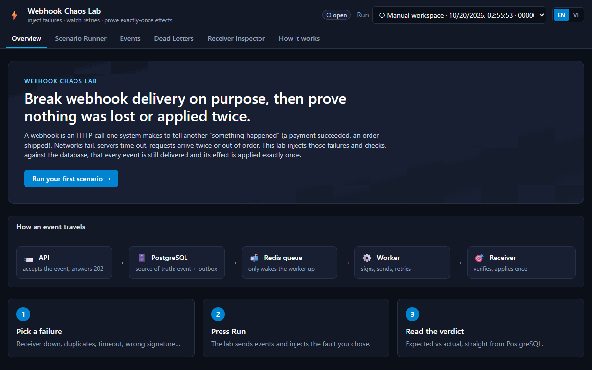
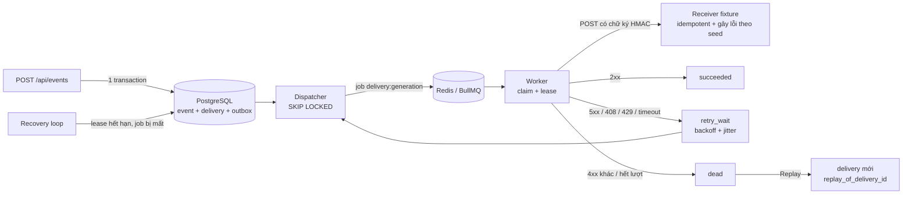

# Webhook Chaos Lab

[English](README.md) · Tiếng Việt

Phòng thí nghiệm "gây hỏng có chủ đích" cho hệ thống gửi webhook: tạo event, cố tình làm hỏng việc
giao (receiver trả 500, timeout sau khi đã commit, gửi trùng, sai thứ tự, sai chữ ký, worker chết,
Redis mất dữ liệu), hiển thị **từng lần thử (attempt)** và kiểm tra hệ thống có tự phục hồi đúng
hay không.

TypeScript fullstack: NestJS 11, Prisma 7 + PostgreSQL, BullMQ + Redis, React 19 + TanStack Query,
Jest, Playwright.



Dashboard có nút chuyển **EN / VI** ở góc phải trên và tab **How it works / Cách hoạt động** giải thích
các khái niệm bằng lời dễ hiểu. Ảnh chụp: [tổng quan (VI)](docs/screenshots/08-overview-vi.png),
[chạy kịch bản](docs/screenshots/02-runner.png), [timeline các lần thử](docs/screenshots/04-attempt-timeline.png),
[phía receiver](docs/screenshots/05-receiver.png), [dead letters](docs/screenshots/06-dead-letters.png).

## Ý tưởng chính trong 30 giây

- **Event ≠ Delivery ≠ Attempt.** Event là sự kiện nghiệp vụ; delivery là một lần "định gửi" event
  đó tới một endpoint; attempt là một lần gọi HTTP thật.
- **PostgreSQL là nguồn sự thật, Redis chỉ để đánh thức worker.** Trạng thái, số lần thử, thời điểm
  thử lại, lease đều nằm trong PostgreSQL. Mất Redis không mất event.
- **Transactional outbox.** Lưu event + delivery + outbox trong _một_ transaction rồi mới trả `202`.
  Dispatcher đọc outbox (`FOR UPDATE SKIP LOCKED`) và đẩy job sang BullMQ.
- **Lease + fencing token + generation.** Worker phải "claim" delivery trước khi gửi. Worker chết
  giữa chừng → lease hết hạn → attempt được ghi `worker_lost` ("không biết kết quả") → gửi lại ở
  generation mới. Worker cũ có sống lại cũng không ghi đè được.
- **Receiver idempotent.** `processed_events` có unique `(consumer_id, event_id)` nằm cùng
  transaction với business effect → gửi trùng 20 lần đồng thời vẫn chỉ có 1 effect.
- **Không hứa exactly-once.** Giao _ít nhất một lần_, effect _đúng một lần_ nhờ idempotency.
  Timeout nghĩa là "sender không biết", không phải "receiver lỗi".



Chi tiết: [docs/architecture.md](docs/architecture.md).

## 7 kịch bản (scenario)

| Kịch bản             | Gây lỗi gì                                        | Phải đúng điều gì                                             |
| -------------------- | ------------------------------------------------- | ------------------------------------------------------------- |
| Healthy              | không                                             | 1 attempt, 1 effect mỗi event                                 |
| Fail twice           | receiver trả 500 ở attempt 1 và 2                 | đúng 3 attempt, 1 effect                                      |
| Duplicate storm      | 20 delivery cùng một event, đồng thời             | 20 request, 1 effect, 19 duplicate                            |
| Timeout after commit | receiver commit xong rồi trả lời chậm hơn timeout | attempt 1 = "không biết", retry = duplicate, 1 effect         |
| Out-of-order         | receiver nhận snapshot theo thứ tự 3, 1, 2        | projection giữ ở 3, bỏ qua 2 bản cũ                           |
| Exhaust and replay   | 500 tới khi hết lượt, rồi receiver khỏe lại       | delivery gốc `dead` giữ nguyên lịch sử, bản replay thành công |
| Invalid signature    | chữ ký HMAC sai                                   | 401, lỗi vĩnh viễn, 0 effect                                  |

Lỗi được sinh từ `seed` nên chạy lại cùng seed cho cùng kết quả. Mỗi run tự so **kỳ vọng và thực tế**
và hiện kết quả trên dashboard.

## Chạy thử

Yêu cầu: Node.js ≥ 22.12, pnpm 10 (`corepack enable`).

### Cách 1: Docker Compose

```bash
docker compose up --build
# Dashboard: http://127.0.0.1:8080   API + Swagger: http://127.0.0.1:3000/api/docs
node scripts/compose-smoke.mjs http://127.0.0.1:8080   # chạy healthy, fail_twice, duplicate_storm
```

> Máy của tác giả không có Docker, nên Compose được kiểm chứng bằng job `compose` trên GitHub
> Actions, xem [docs/verification.md](docs/verification.md).

### Cách 2: Không cần Docker

```bash
pnpm install
pnpm build
pnpm infra:local                 # PostgreSQL :5440 + Redis :6390 (để terminal này chạy)
# ở terminal khác, đặt biến môi trường theo .env.example rồi:
pnpm db:migrate && pnpm db:seed
node apps/receiver/dist/main.js
node apps/worker/dist/main.js
node apps/api/dist/main.js
pnpm --filter @lab/web dev       # http://127.0.0.1:5173
```

Kịch bản demo từng bước: [docs/demo-script.md](docs/demo-script.md).

## Kiểm thử

```bash
pnpm lint && pnpm format:check && pnpm typecheck
pnpm test:unit                   # 80 unit test (policy thuần, không cần DB)
pnpm test:integration            # 77 test với PostgreSQL + Redis thật (cần pnpm build trước)
pnpm e2e                         # 8 bài Playwright trên stack đầy đủ
node scripts/load-test.mjs --events 1000 --concurrency 20   # load test có giới hạn
pnpm chaos worker                # giết worker giữa lúc tải (cũng có: receiver, redis, redis-loss)
```

Integration test bao gồm cả các "cửa sổ sập": sập sau commit nhưng trước enqueue, Redis tắt, Redis
mất dữ liệu queue, receiver tắt rồi bật lại, worker bị `SIGKILL` sau khi receiver đã commit, job chạy
lại sau khi delivery đã kết thúc, hai worker tranh một delivery.

`pnpm chaos <worker|receiver|redis|redis-loss>` tự dựng một stack riêng (DB `lab_chaos`, Redis
riêng), bắn 300 event, **giết thật** thành phần được chọn ở giây thứ 1, bật lại sau 5 giây, rồi đếm
trong PostgreSQL: mọi event đều được giao và mỗi event đúng 1 effect. Cả 4 chế độ đều pass trên máy
local và chạy trong CI.

Kết quả thực tế, máy đo và những gì **chưa** chạy được: [docs/verification.md](docs/verification.md).

## Số liệu đo thật (local, một máy)

Load test 1000 event, 20 request đồng thời, stack chạy native trên Windows 11
(i5-12450HX, 12 luồng, 12 GB RAM, PostgreSQL 18 embedded, Redis 8):

| Chỉ số                                    | Giá trị                              |
| ----------------------------------------- | ------------------------------------ |
| Event được nhận (`202`)                   | 214 event/giây                       |
| Delivery thành công                       | 204 delivery/giây, 1000/1000, 0 dead |
| Thời gian nhận request (p50 / p95)        | 94 / 108 ms                          |
| Từ lúc nhận tới khi giao xong (p50 / p95) | 345 / 370 ms                         |

Đây là số của một máy dev, không phải benchmark production. Độ trễ end-to-end chủ yếu do chu kỳ
poll của dispatcher (`DISPATCH_POLL_MS=250`).

## Cấu trúc thư mục

```
apps/api        NestJS API + dispatcher + recovery + scenario supervisor
apps/worker     BullMQ worker gửi webhook
apps/receiver   receiver fixture (HMAC, idempotency, gây lỗi)
apps/web        dashboard React (EN / VI)
packages/shared policy thuần: retry, backoff, HMAC, fault plan, scenario
packages/db     Prisma schema, migrations, delivery engine
tests/          integration test (PostgreSQL + Redis thật)
scripts/        infra local, e2e stack, smoke test, load test
docs/           kiến trúc, kịch bản demo, kết quả kiểm chứng, ảnh chụp
```
