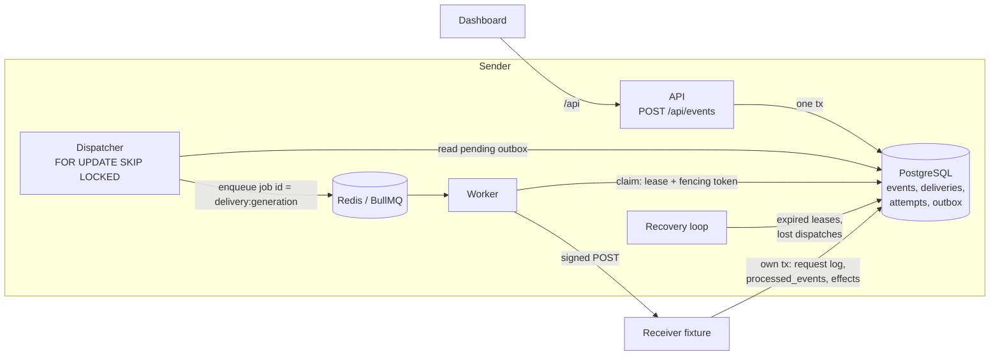

# Architecture

Webhook Chaos Lab is a small, complete webhook delivery system plus a fault-injecting receiver.
It exists to show (and test) what happens to webhooks when things go wrong: receivers that fail,
time out, answer twice, see events out of order, or when the sender's own worker or Redis dies.

## Components

| Component     | Path              | Role                                                                                                                                                                                |
| ------------- | ----------------- | ----------------------------------------------------------------------------------------------------------------------------------------------------------------------------------- |
| API           | `apps/api`        | NestJS. Accepts events, starts scenario runs, serves read models, replays dead letters. Also runs the outbox **dispatcher**, the **recovery** loop and the **scenario supervisor**. |
| Worker        | `apps/worker`     | BullMQ consumer. Claims a delivery in PostgreSQL, sends the signed HTTP request, records the attempt.                                                                               |
| Receiver      | `apps/receiver`   | A webhook consumer fixture: verifies HMAC, deduplicates, applies business effects, and injects faults from the run's seeded fault plan.                                             |
| Dashboard     | `apps/web`        | React 19 + TanStack Query. Scenario runner, event/attempt timeline, dead letters, receiver inspector.                                                                               |
| `@lab/shared` | `packages/shared` | Pure policy code: envelope schema, HMAC sign/verify, retry classification and backoff, seeded fault plans, scenario blueprints, config.                                             |
| `@lab/db`     | `packages/db`     | Prisma schema/migrations and the delivery engine (claim, complete, dispatch, recovery, replay, runs, metrics).                                                                      |

## The delivery pipeline

1. **Accept.** `POST /api/events` validates the payload, then in **one transaction** inserts the
   `event`, one or more `deliveries` (state `queued`) and an `outbox` row per delivery. The API
   answers `202` once that transaction commits. Redis is not touched on this path, so an event is
   accepted even while Redis is down.
2. **Dispatch.** A polling dispatcher locks due outbox rows with `FOR UPDATE SKIP LOCKED`,
   enqueues them to BullMQ with job id `deliveryId:generation`, and only then marks them
   `published`. A crash between enqueue and commit just re-publishes the same job id.
3. **Claim.** The worker does a conditional `UPDATE` that succeeds only if the delivery is not
   terminal, the job's generation equals the delivery's current generation, and no other valid
   lease exists. The claim sets `lease_until` and a fresh `claim_token` (fencing token) and inserts
   the attempt row (`in_progress`).
4. **Send.** No DB transaction is held during HTTP. The request carries `x-lab-event-id`,
   `x-lab-delivery-id`, `x-lab-attempt-no`, `x-lab-timestamp` and
   `x-lab-signature: v1=<hex HMAC-SHA256(timestamp.rawBody)>`. Redirects are off, the response
   body is read up to 8 KiB, and only allowlisted fixture URLs can be targeted.
5. **Complete.** The result is written only if the claim token still matches (a worker whose lease
   was taken over cannot overwrite the newer state). The retry policy decides:
   - `2xx` → `succeeded`
   - `408`, `429`, `5xx`, network errors, timeouts → `retry_wait` with `next_attempt_at`
     (exponential backoff with seeded jitter, `Retry-After` honoured but clamped) and a new outbox
     row for the next generation
   - other `4xx`/`3xx` → `dead` (permanent)
   - attempts exhausted → `dead`
6. **Replay.** A dead delivery can be replayed: this creates a **new** delivery linked by
   `replay_of_delivery_id`. The original keeps its full attempt history and stays `dead`.

### Why PostgreSQL owns retries (and BullMQ `attempts = 1`)

Redis is a wake-up mechanism, not the source of truth. Every fact that matters (state, attempt
count, next attempt time, lease) lives in PostgreSQL, and every queue job is re-checked against
it on claim. Consequences:

- Losing Redis data loses no events. The **recovery loop** re-issues deliveries whose dispatch was
  published but never claimed within `DISPATCH_GRACE_MS` (new generation, new outbox row).
- A worker that dies mid-attempt leaves an expired lease. Recovery marks that attempt
  `worker_lost` (outcome **unknown at sender**), bumps the generation and schedules a retry.
- Stale or duplicate jobs (old generation, terminal delivery) are rejected without any HTTP call.

### Event ≠ Delivery ≠ Attempt

- An **event** is a business fact with a stable `eventId` and `payload_hash`.
- A **delivery** is one intent to get that event to one endpoint. There is intentionally **no**
  unique `(eventId, endpointId)`: the duplicate storm and replays need several deliveries for the
  same event.
- An **attempt** is one HTTP try, unique per `(deliveryId, attemptNo)`.

## Receiver idempotency

The receiver runs its own transaction per request:

1. Insert a `receiver_requests` row (the inspector's log, including rejected requests).
2. Verify the HMAC signature over the **raw body** with a constant-time compare and a 5-minute
   timestamp window. Invalid → `401`, nothing else happens.
3. `INSERT INTO processed_events (consumer_id, event_id, payload_hash) ... ON CONFLICT DO NOTHING`.
   - inserted → apply the business effect (counter increment, or order projection that only moves
     forward by sequence) and `business_effects` row (also unique per consumer+event).
   - conflict with the same hash → `200 duplicate`, no effect.
   - conflict with a different hash → `409 payload_conflict`.

Because the dedupe is a unique key inside the same transaction as the effect, concurrent
duplicates cannot both apply the effect (the duplicate storm checks this with 20 concurrent
deliveries).

## Delivery guarantees (and non-guarantees)

- **At-least-once** delivery, **effectively-once** business effects at the receiver via
  idempotency. The system does not claim exactly-once delivery.
- A timeout means "unknown at sender": the receiver may have committed (see the
  `timeout_after_commit` scenario). The retry is safe only because the receiver deduplicates.
- Ordering is not guaranteed by the transport. The receiver protects its projection with the
  event's `sequence` (the `out_of_order` scenario delivers 3, 1, 2 and the projection stays at 3).

## Scenarios and determinism

A scenario run stores a config snapshot and a **fault plan** derived from
`hash(seed, eventIndex, deliveryOrdinal, attemptNo)`, so the same seed produces the same faults.
Only one run may be active at a time; every run's data is tagged with its `run_id`. A supervisor
advances the run through its steps and evaluates expected-vs-actual assertions from
`computeRunMetrics`.

| Scenario               | What is injected                                          | What must hold                                             |
| ---------------------- | --------------------------------------------------------- | ---------------------------------------------------------- |
| `healthy`              | nothing (optional seeded chaos rate)                      | 1 attempt, 1 effect per event                              |
| `fail_twice`           | 500 before commit on attempts 1 and 2                     | exactly 3 attempts, 1 effect                               |
| `duplicate_storm`      | 20 deliveries of one event, concurrently                  | 20 requests, 1 effect, 19 duplicates                       |
| `timeout_after_commit` | receiver commits, then answers after the sender's timeout | attempt 1 = timeout (unknown), retry = duplicate, 1 effect |
| `out_of_order`         | snapshots received as 3, 1, 2                             | projection at 3, 2 stale ignored                           |
| `exhaust_and_replay`   | 500 until the budget is spent, then healthy               | original dead with history, replay succeeds                |
| `invalid_signature`    | bad HMAC                                                  | 401, permanent failure, 0 effects                          |

## Security notes

- Destinations come from a server-side allowlist (exact origin, path prefix); no credentials or
  fragments in URLs; redirects disabled; response reads capped.
- Endpoints store the **name** of the secret variable (`secret_ref`), not the secret.
- All published ports bind to `127.0.0.1`. Sample secrets in `.env.example` and
  `docker-compose.yml` are local-only placeholders.
